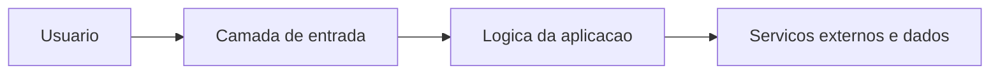

# Arquitetura — next-frontend

Tecnologias: Next.js, TypeScript, React e Google Maps. Principais referências: src/app/, src/hooks/, src/utils/, package.json.

Modelo inicial de responsabilidades. Não é um diagrama exato da infraestrutura existente. Preserve contratos públicos e isole dependências externas para permitir testes.

**Limite:** O README antigo chamava o frontend de Golang, mas o código é Next.js. Integração depende de backend, Google Maps e variáveis .env.
